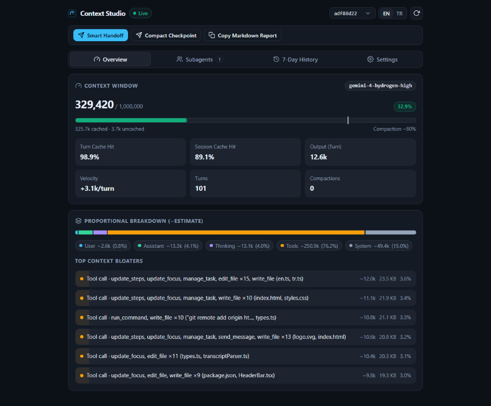
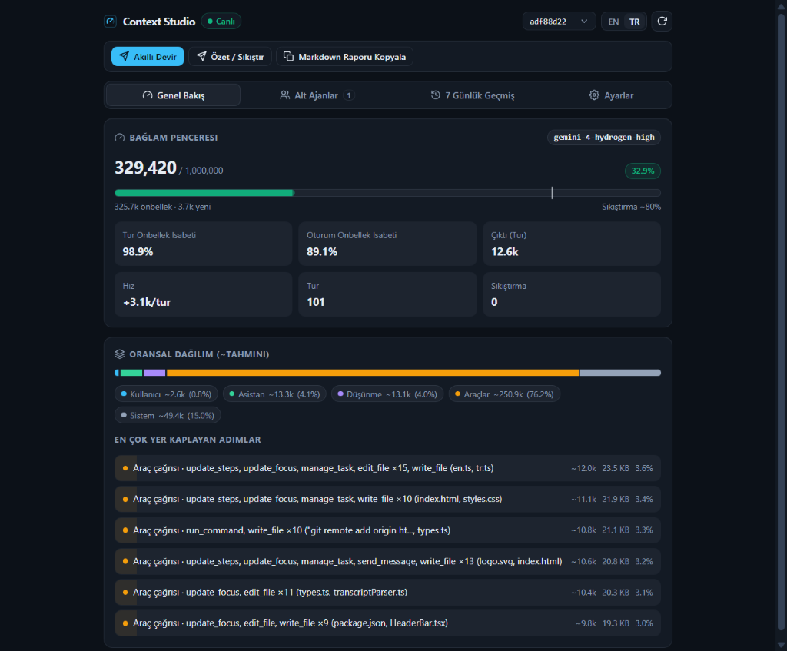
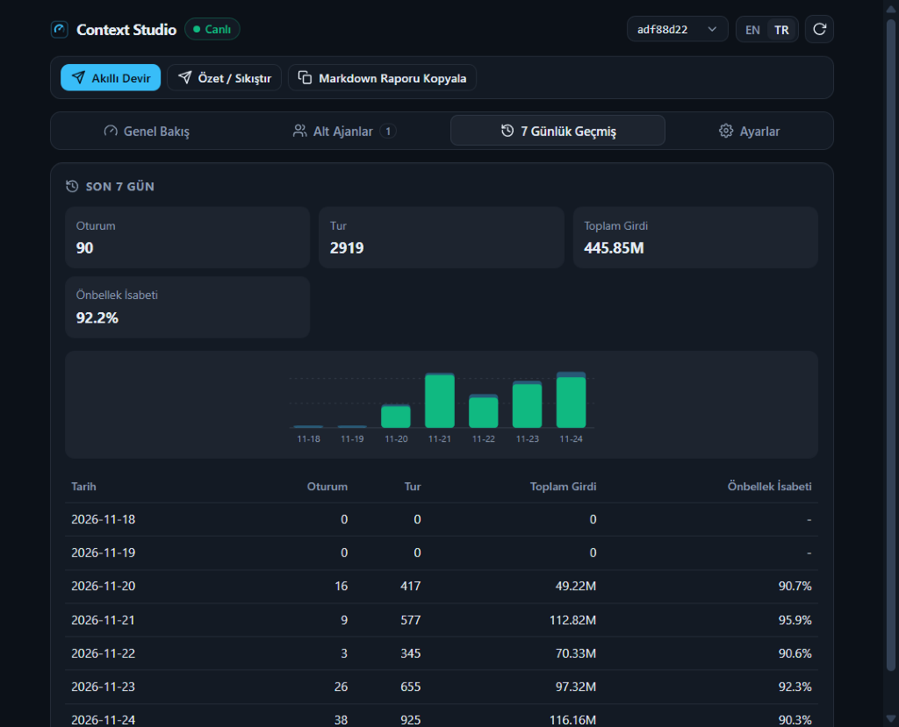
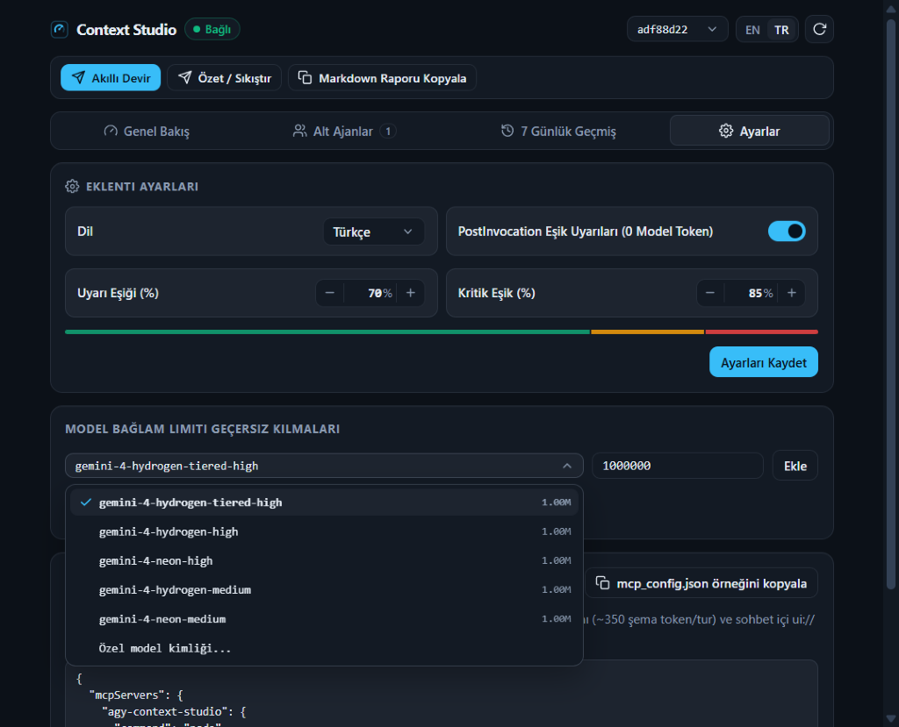
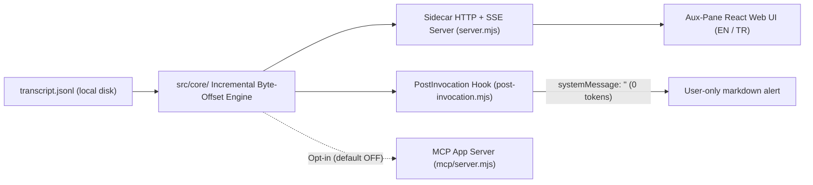

<div align="center">
  
  <h1>agy-context-studio</h1>
  <p><strong>Zero-token-overhead Context Window Monitor &amp; Manager for Google Antigravity</strong></p>
  <p>
    <strong>English</strong> ·
    <a href="README.tr.md">Türkçe</a> ·
    <a href="https://brhnshn.github.io/agy-context-studio/">Live Showcase</a> ·
    <a href="SPEC.md">Technical Spec</a> ·
    <a href="CHANGELOG.md">Changelog</a>
  </p>
</div>

---

`agy-context-studio` gives Google Antigravity (Desktop 2.0, IDE, and CLI) users real-time visibility and practical control over their active LLM context window without consuming model tokens to monitor itself.

## Screenshots

| Overview (English) | Overview (Turkish) |
| :---: | :---: |
|  |  |

| 7-Day History | Settings & Detected Models |
| :---: | :---: |
|  |  |

---

## Key Features (3 Modular Options)

1. **Option 1 — Live Sidecar Web UI Monitor (Default: ON · 0 Tokens)**
   - **Exact Context Fill:** Reads `input_tokens + cache_read_tokens` from local `transcript.jsonl` via incremental byte-offset parsing and streams updates over SSE (`fs.watch`).
   - **Dual-Segment Fill Meter:** Visualizes cached vs. uncached tokens alongside the model's auto-compaction marker (`Compaction ~80%`).
   - **Prompt Cache Diagnostics:** Shows turn-level and cumulative session Prompt Cache hit percentages and token velocity (`tokens/turn`).
   - **Proportional Breakdown (`~estimate`) & Top Bloaters:** Interactive category filter pills (`User`, `Assistant`, `Thinking`, `Tools`, `System`) and deduplicated tool summaries (`edit_file ×15 (en.ts, tr.ts)`).
   - **Subagents & 7-Day History:** Tracks spawned subagents (`invoke_subagent`) and aggregates local 7-day token volume and cache savings.
   - **Built-in EN / TR Switcher:** Instant UI and hook alert localization synced with Antigravity's light/dark theme.

2. **Option 2 — Automatic Threshold Warnings via `PostInvocation` Hook (Toggleable · 0 Model Tokens)**
   - Evaluates context fill after every model turn against configurable warning (`70%`) and critical (`85%`) thresholds.
   - Emits a user-only markdown card (`metadata.user_markdown` with `systemMessage: ""`) once per threshold per session and resets automatically after compaction.

3. **Option 3 — Interactive Context Manager (Top Quick Actions + Opt-In MCP App)**
   - **Layer 3A — Sidecar Quick Actions (Default: ON · 0 Background Tokens):** Compact top toolbar offering one-click **Smart Handoff**, **Compact Checkpoint**, and **Copy Markdown Report** via `window.sidecar.agent.sendMessage()` (with clipboard fallback).
   - **Layer 3B — Opt-In MCP App (Default: OFF):** Optional `get_context_health` tool + inline `ui://agy-context-studio/card.html` conversation card ([mcp/mcp_config.template.json](mcp/mcp_config.template.json)).

---

## Architecture



---

## Quick Start & Local Installation

Requires **Node.js >= 22**. All runtime outputs (`sidecars/agy-context-studio/server.mjs`, `sidecars/agy-context-studio/public/`, `hooks/post-invocation.mjs`, `mcp/server.mjs`) are pre-built and dependency-free.

```bash
git clone https://github.com/brhnshn/agy-context-studio.git
cd agy-context-studio
npm install
npm run build
npm test
npm run link:plugin
```

`npm run link:plugin` links/copies the built plugin into `~/.gemini/config/plugins/agy-context-studio` without touching `~/.gemini/config/config.json`. Restart Antigravity to see **Context Studio** in the auxiliary pane, or launch the standalone sidecar directly for browser testing:

```bash
node sidecars/agy-context-studio/server.mjs
# Open http://127.0.0.1:3847
```

---

## Roadmap & Phase 2

See [`ROADMAP.md`](ROADMAP.md) for completed Phase 1 (`v0.1.0`) milestones and upcoming **Phase 2 (`avenoxai/avenoxbeyin`)** integration plans.

## Contributing & License

Contributions are welcome — see [`CONTRIBUTING.md`](CONTRIBUTING.md). Released under the [MIT License](LICENSE).
