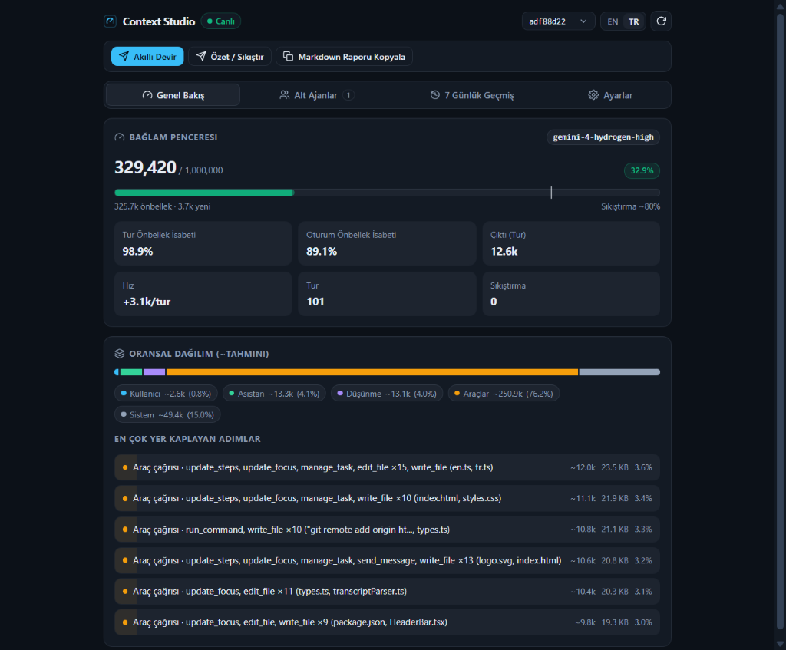
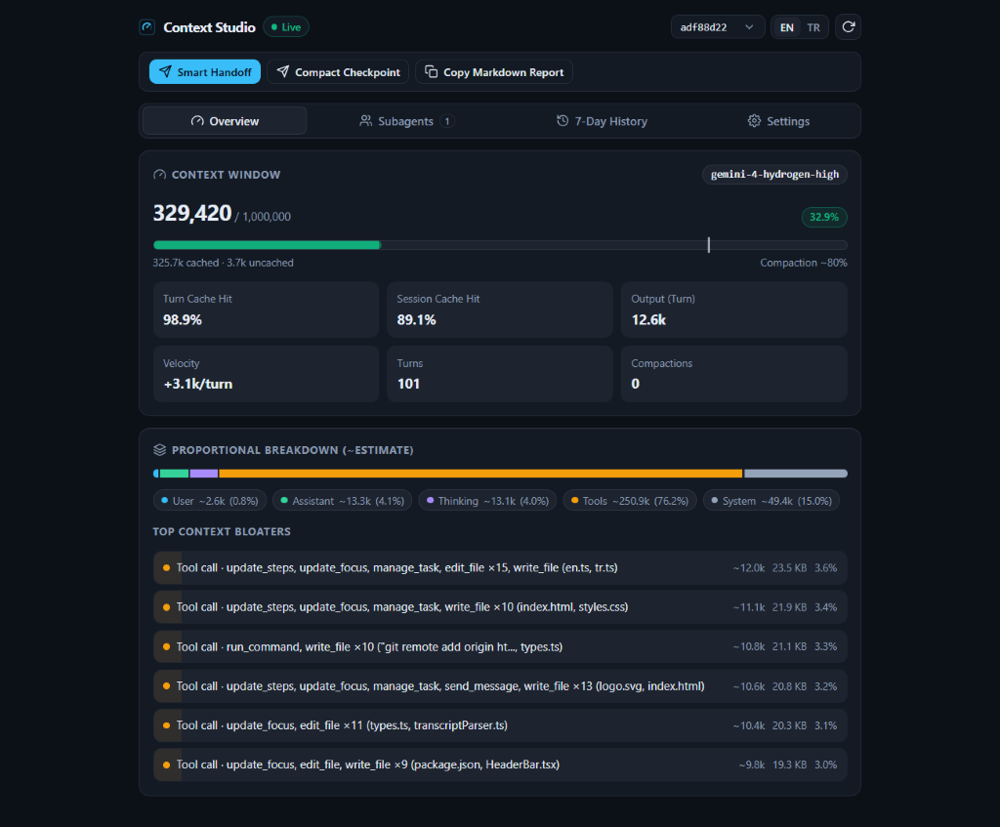
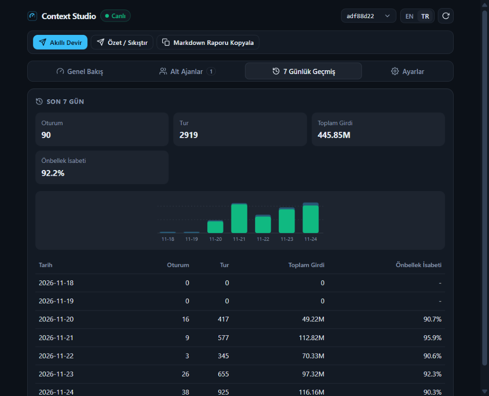
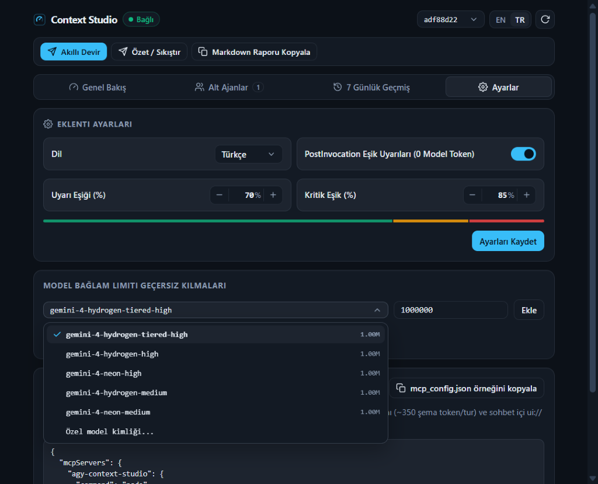

<div align="center">
  
  <h1>agy-context-studio</h1>
  <p><strong>Google Antigravity için Sıfır Token Maliyetli Bağlam Penceresi İzleyicisi ve Yöneticisi</strong></p>
  <p>
    <a href="README.md">English</a> ·
    <strong>Türkçe</strong> ·
    <a href="https://brhnshn.github.io/agy-context-studio/">Tanıtım Sitesi</a> ·
    <a href="SPEC.md">Teknik Şartname</a> ·
    <a href="CHANGELOG.md">Değişiklik Günlüğü</a>
  </p>
</div>

---

`agy-context-studio`, Google Antigravity (Desktop 2.0, IDE ve CLI) oturumlarınızda aktif LLM bağlam penceresini kendi kendini izlemek için **hiç model tokenı harcamadan** gerçek zamanlı görünürlük ve kontrol sunar.

## Ekran Görüntüleri

| Genel Bakış (Türkçe) | Genel Bakış (İngilizce) |
| :---: | :---: |
|  |  |

| 7 Günlük Geçmiş | Ayarlar ve Algılanan Modeller |
| :---: | :---: |
|  |  |

---

## Temel Özellikler (3 Modüler Seçenek)

1. **Seçenek 1 — Canlı Sidecar Web Arayüzü (Varsayılan: AÇIK · 0 Token)**
   - **Gerçek Bağlam Doluluğu:** Yerel `transcript.jsonl` dosyalarını bayt konumuyla artımlı okuyarak (`fs.watch` + SSE) gerçek `input_tokens + cache_read_tokens` değerlerini canlı aktarır.
   - **Çift Segmentli Doluluk Çubuğu:** Önbellekten okunan (`önbellek`) ve yeni (`yeni`) token oranlarını modelin sıkıştırma eşiği işaretçisiyle (`Sıkıştırma ~%80`) gösterir.
   - **Prompt Cache Analizi:** Tur bazlı ve oturum geneli önbellek isabet oranını, çıktı tokenlarını ve tur başına bağlam büyüme hızını (`/tur`) hesaplar.
   - **Oransal Dağılım (`~tahmini`) ve En Çok Yer Kaplayan Adımlar:** Tıklanabilir kategori filtre hapları (`Kullanıcı`, `Asistan`, `Düşünme`, `Araçlar`, `Sistem`) ve tekilleştirilmiş araç özetleri (`edit_file ×15 (en.ts, tr.ts)`).
   - **Alt Ajanlar ve 7 Günlük Geçmiş:** Başlatılan alt ajanların (`invoke_subagent`) token özetlerini ve son 7 günlük yerel önbellek tasarrufunu listeler.

2. **Seçenek 2 — `PostInvocation` Otomatik Eşik Uyarıları (Aç/Kapa · 0 Model Token)**
   - Her model turundan sonra bağlam doluluğunu ayarlanabilir uyarı (`%70`) ve kritik (`%85`) eşiklerine göre denetler.
   - `systemMessage: ""` ve `metadata.user_markdown` kullanarak **model bağlamına tek bir token eklemeden** yalnızca kullanıcıya şık bir uyarı kartı gösterir; oturum başına tekilleştirir ve sıkıştırma sonrası kendini sıfırlar.

3. **Seçenek 3 — Etkileşimli Bağlam Yöneticisi (Üst Araç Çubuğu + İsteğe Bağlı MCP App)**
   - **Katman 3A — Sidecar Hızlı İşlemler (Varsayılan: AÇIK · 0 Arka Plan Token):** Üst araç çubuğundan tek tıkla **Akıllı Devir**, **Özet / Sıkıştır** ve **Markdown Raporu Kopyala** işlemlerini çalıştırır.
   - **Katman 3B — İsteğe Bağlı MCP App (Varsayılan: KAPALI):** Modelin kendisinin bağlam sağlığını sorgulamasını isteyenler için `get_context_health` aracı ve `ui://agy-context-studio/card.html` sohbet içi kartı ([mcp/mcp_config.template.json](mcp/mcp_config.template.json)).

---

## Kurulum ve Yerel Test

**Node.js >= 22** gerektirir. Tüm çalışma paketleri harici `node_modules` gerektirmeyen sıfır bağımlılıklı ESM çıktıları olarak derlenir.

```bash
git clone https://github.com/brhnshn/agy-context-studio.git
cd agy-context-studio
npm install
npm run build
npm test
npm run link:plugin
```

`npm run link:plugin` eklentiyi `~/.gemini/config/plugins/agy-context-studio` dizinine bağlar (`config.json` dosyasına dokunmaz). Antigravity'yi yeniden başlattığınızda yan panelde görünür veya doğrudan tarayıcıda açabilirsiniz:

```bash
node sidecars/agy-context-studio/server.mjs
# Tarayıcıda açın: http://127.0.0.1:3847
```

---

## Yol Haritası ve Faz 2

Tamamlanan Faz 1 (`v0.1.0`) aşamaları ve yaklaşan **Faz 2 (`avenoxai/avenoxbeyin`)** entegrasyon planı için [`ROADMAP.md`](ROADMAP.md) dosyasına göz atabilirsiniz.

## Katkı ve Lisans

Katkılarınızı bekliyoruz — ayrıntılar için [`CONTRIBUTING.md`](CONTRIBUTING.md). [MIT Lisansı](LICENSE) ile lisanslanmıştır.
